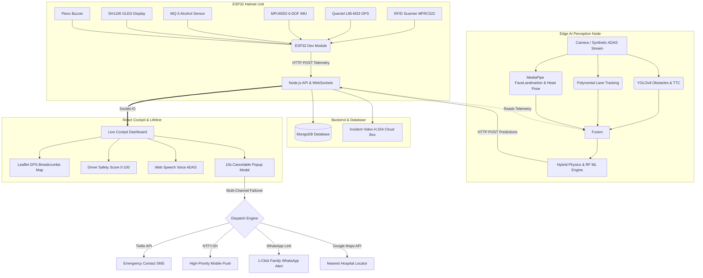

# DivyaDrishti (दिव्यदृष्टि) - Smart Helmet AI & Telemetry System

DivyaDrishti is a next-generation smart helmet and AI pipeline designed to enhance motorcycle rider safety. It fuses real-time hardware telemetry (GPS, MPU6050 Accelerometer/Gyroscope, MQ-3 Alcohol Sensor, RFID) with advanced computer vision (YOLO object detection, Lane Departure, Drowsiness & Head Pose Distraction tracking, Forward Collision Warning) to predict and mitigate accident risks using a hybrid physics and Random Forest machine learning engine.

## 🚀 Features & Enhancements

- **End-to-End Hardware Integration**: ESP32 interfaces with Quectel L86-M33 GPS, MPU6050 6-axis motion IMU, MQ-3 alcohol sensor, SH1106 OLED, and an MFRC522 RFID reader.
- **Secure Sessions**: RFID-based rider authentication with automatic session heartbeat watchdog and claim verification.
- **Computer Vision & ADAS Pipeline**:
  - **YOLOv8 Object Detection**: Estimates real-time obstacle distance in meters using pinhole camera optics.
  - **Forward Collision Warning (FCW)**: Continuously evaluates Time-to-Collision (TTC) based on approach velocity and warns when TTC < 2.5s.
  - **Driver Drowsiness & Fatigue**: Real-time geometric Eye Aspect Ratio (EAR) + facial blendshape tracking with 10-second unconsciousness SOS safeguard.
  - **3D Head Pose & Inattention Tracking**: Estimates 3D head yaw/pitch using `cv2.solvePnP` to detect distracted riding (looking away from road or down at phone > 2.5s).
  - **Polynomial Lane Departure Detection**: Tracks lane boundary deviation and flags vehicle drift.
- **Sensor Fusion Hybrid Risk Engine**: Blends localized helmet motion, alcohol vapors, and edge vision metrics into actionable event classifications (`NORMAL`, `LANE_DEPARTURE`, `DROWSINESS`, `FORWARD_COLLISION_WARNING`, `DISTRACTED`, `IMPACT`, `FALL`).
- **Driver Safety Score Engine (0-100)**: Real-time driver grading (`A+`, `A`, `B`, `C`) evaluating ride smoothness, penalizing violations, and rewarding safe driving.
- **Interactive Cockpit & GPS Breadcrumbs**: Live Leaflet / OpenStreetMap route polyline trail displaying recorded path waypoints and real-time sensor dynamics.
- **Web Speech API Voice ADAS**: Natural spoken voice announcements for critical road hazards ("Warning: Lane Departure", "Caution: Forward Collision Ahead", "Crash Detected").
- **10-Second Cancelable Emergency Lifeline**:
  - Automatically triggers when high G-force (>25G) or AI collision is detected.
  - 10-second cancel button to prevent false alarms.
  - Multi-tier alert failover: Twilio SMS + NTFY.sh instant mobile push + auto-uploaded 10-second H.264 video black box clip.
  - 1-Click WhatsApp SOS link with pre-filled crash details and Google Maps pin.
  - Instant 1-click Nearest Hospital / Trauma Center navigation finder.
- **Good Samaritan QR Lifeline Portal**: Standalone emergency mobile portal accessed by scanning the helmet sticker, with 1-click bystander phone GPS bridging directly to helmet backend.
- **Autonomous Android Mobile System (`android/`)**:
  - 100% standalone and offline-first Android application designed for moderate smartphones (4GB RAM, medium processor) with zero mandatory network dependencies.
  - Traditional authentication system: Email/Username + salted SHA-256 password login and registration with local Room database persistence.
  - High-G collision (>4.5G) and motorcycle rollover/fall (>65° roll/pitch) detection using on-device mobile accelerometer and gyroscope sensor fusion.
  - Real-time Driver Safety Score (0–100) with grade indicator (`A+`, `A`, `B`, `C`), penalty deductions, and smooth driving recovery.
  - Native Android `TextToSpeech` Voice ADAS spoken warnings with mute toggle.
  - 10-second cancelable SOS emergency window with direct cellular `SmsManager` dispatch, 1-Click WhatsApp Lifeline URL, and 1-tap Nearest Hospital navigation.
  - Battery-optimized adaptive sensor sampling (low power mode when stationary, high-rate game mode during active rides) using 0 KB background cellular data.

## 🏗 System Architecture



## 🎮 Interactive Simulation Hotkeys

When testing the AI pipeline in Simulation Mode (`python main.py -t`), use these hotkeys in the video window:

| Key | Simulated Event | System Response |
| :---: | :--- | :--- |
| **`[C]`** | **Forward Collision Warning** | Approaching lead vehicle, calculates TTC = 1.4s, triggers visual HUD & Voice ADAS |
| **`[H]`** | **Head Pose Distraction** | Driver turns head away (>35° yaw) for > 2.5s, triggers Inattention warning |
| **`[D]`** | **Drowsiness / Fatigue** | Driver eyes closed (< 0.15 EAR), activates microsleep warning |
| **`[U]`** | **Unconscious Driver SOS** | Driver eyes closed > 10s, exports 10s video clip, triggers Emergency SOS modal |
| **`[L]`** | **Lane Departure** | Vehicle drifts across lane boundary, alerts rider to re-center |
| **`[I]`** | **Crash / Collision Impact** | High-G deceleration, initiates 10s cancellation countdown & video black box |
| **`[N]`** | **Normal State** | Restores smooth driving state, begins Safety Score recovery |
| **`[T]`** | **Toggle Camera / Sim** | Swaps between physical webcam and synthetic ADAS road generator |
| **`[Q]`** | **Quit Pipeline** | Gracefully cleans up video buffers and exits |

## 🛠 Setup & Installation

### 1. Node.js Backend
```bash
cd backend
npm install
node tests/systemEnhancements.test.js  # Run test suite
npm run dev                           # Starts backend on http://localhost:5000
```

### 2. React Dashboard
```bash
cd dashboard
npm install
npm run build                         # Verify build
npm run dev                           # Starts dashboard on http://localhost:5173
```

### 3. AI Pipeline
```bash
cd ai
venv\Scripts\activate
# Train models and generate evaluation metrics:
python models/train.py
# Start interactive perception node:
python main.py -t
```

### 4. ESP32 Firmware
- Open `Esp32/esp32connection/esp32connection.ino` in the Arduino IDE.
- Update `WIFI_SSID` and `WIFI_PASSWORD`.
- Flash to your ESP32 board.

### 5. Autonomous Android Mobile App (100% Standalone & Offline-First)

The Android mobile version functions completely independently without needing backend servers or internet connectivity:

```bash
cd android

# Run all 8 automated subsystem tests:
.\gradlew testDebugUnitTest

# Assemble debug APK (outputs to android/app/build/outputs/apk/debug/app-debug.apk):
.\gradlew assembleDebug
```

