# DivyaDrishti (दिव्यदृष्टि) - Smart Helmet AI & Telemetry System

DivyaDrishti is a next-generation smart helmet and AI pipeline designed to enhance motorcycle rider safety. It fuses real-time hardware telemetry (GPS, MPU6050 Accelerometer/Gyroscope, MQ-3 Alcohol Sensor, RFID) with advanced computer vision (YOLO object detection, Lane Departure, Drowsiness detection) to predict and mitigate accident risks using a custom Random Forest machine learning model.

## 🚀 Features

- **End-to-End Hardware Integration**: ESP32 interfaces with GPS, MPU6050, MQ-3, and an RFID reader.
- **Secure Sessions**: RFID-based secure login and session management via HTTP-only cookies and MongoDB.
- **Computer Vision Pipeline**: Processes camera feeds in real-time to detect objects, lane departure, and rider drowsiness (EAR tracking).
- **Sensor Fusion ML**: Combines hardware telemetry and vision data into a single vector fed into a Random Forest model, predicting `NORMAL`, `TURNING`, `BRAKING`, `LANE_DEPARTURE`, `DROWSINESS`, and `IMPACT`.
- **Live React Dashboard**: High-speed telemetry streaming via Socket.IO, rendering beautiful historical charts (Recharts) and live dark-mode GPS maps (Leaflet/OpenStreetMap).
- **Automated Emergency System**: Detects crashes, initiates a 10-second cancelable countdown on the dashboard, and integrates with Twilio to fire off real-time SMS alerts (with Google Maps location) to emergency contacts.

## 🏗 System Architecture

```mermaid
flowchart TD
    subgraph Hardware [ESP32 Helmet]
        RFID[RFID Scanner] --> ESP(ESP32 Microcontroller)
        GPS[GPS Module] --> ESP
        MPU[MPU6050 Motion] --> ESP
        MQ3[MQ-3 Alcohol] --> ESP
        ESP -->|HTTP POST Telemetry| Node[Node.js API & WebSockets]
    end

    subgraph Vision [Laptop AI Pipeline]
        Cam[Webcam] --> YOLO(YOLOv8 Objects)
        Cam --> Lane(Lane Detection)
        Cam --> Face(MediaPipe Drowsiness)
        YOLO --> Fusion
        Lane --> Fusion
        Face --> Fusion
        Node -.->|Reads Telemetry| Fusion
        Fusion --> RF[Random Forest ML]
        RF -->|HTTP POST Predictions| Node
    end
    
    subgraph Cloud [Backend & DB]
        Node --> DB[(MongoDB Atlas)]
    end

    subgraph Interface [React Dashboard]
        Node == Socket.IO ==> React[Live Dashboard]
        React --> Map[Leaflet GPS Map]
        React --> Charts[Historical Data]
        React --> Emergency[10s Countdown]
    end
    
    Emergency -->|POST /emergency| Node
    Node -->|Twilio API| SMS[Family SMS Alert]
```



## 🔌 Hardware Circuit Diagram

```
[ ESP32 ]
  3V3  ------> VCC of MPU6050, RFID (MFRC522), GPS
  GND  ------> GND of MPU6050, RFID, GPS, MQ3, Buzzer
  D21  ------> SDA (MPU6050)
  D22  ------> SCL (MPU6050)
  D5   ------> SDA/SS (RFID)
  D18  ------> SCK (RFID)
  D19  ------> MISO (RFID)
  D23  ------> MOSI (RFID)
  D16  ------> RX (GPS)
  D17  ------> TX (GPS)
  D34  ------> A0 (MQ-3)
  D4   ------> + (Buzzer)
```

## 🛠 Setup & Installation

### 1. Node.js Backend
```bash
cd backend
npm install
# Create a .env file with PORT=5000, MONGO_URI, and TWILIO credentials
npm run dev
```

### 2. React Dashboard
```bash
cd dashboard
npm install
npm run dev
```

### 3. AI Pipeline
```bash
cd ai
python -m venv venv
venv\Scripts\activate
pip install -r requirements.txt
# Run the synthetic data generator and train the ML models first:
python models/ml_pipeline.py
# Start the live vision pipeline:
python main.py
```

### 4. ESP32 Firmware
- Open `Esp32/esp32connection/esp32connection.ino` in the Arduino IDE.
- Update `WIFI_SSID` and `WIFI_PASSWORD`.
- Flash to your ESP32.

## 📱 Twilio SMS Integration
To enable SMS alerts, set the following in your `backend/.env` file:
```env
TWILIO_ACCOUNT_SID=your_account_sid
TWILIO_AUTH_TOKEN=your_auth_token
TWILIO_PHONE_NUMBER=+1234567890
EMERGENCY_CONTACT_NUMBER=+1098765432
```

## 🔮 Future Scope
- Hardware miniaturization onto a custom PCB.
- 5G cellular module (SIM800L / SIM7000) for direct-to-cloud helmet telemetry.
- Android/iOS mobile application wrapper for the React Dashboard.
- Training the Random Forest model on real-world collected dataset rather than synthetic permutations.
